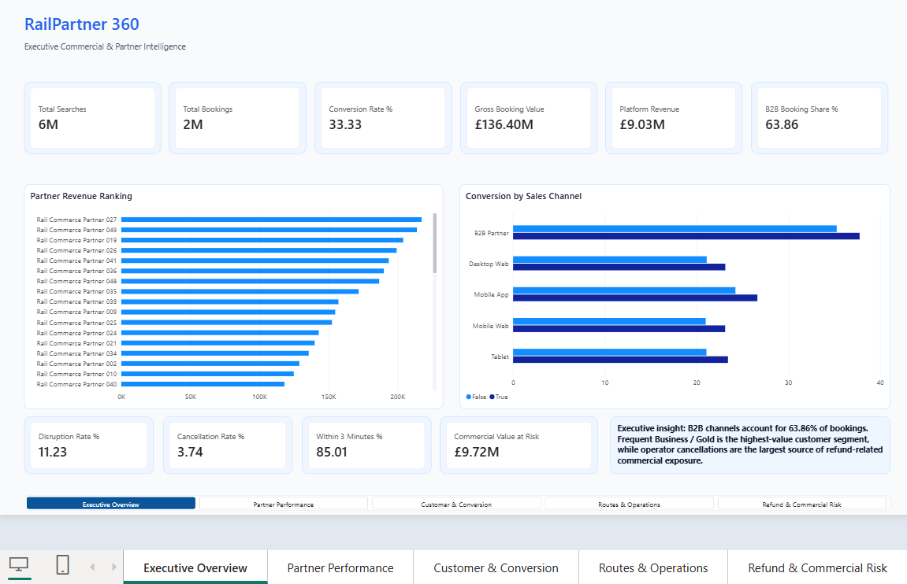
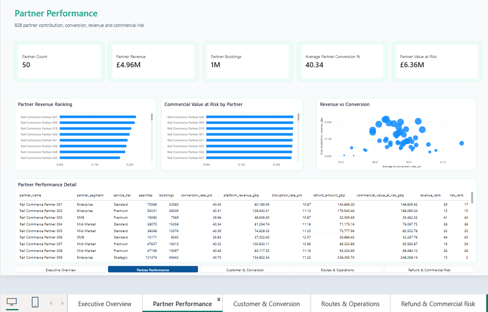
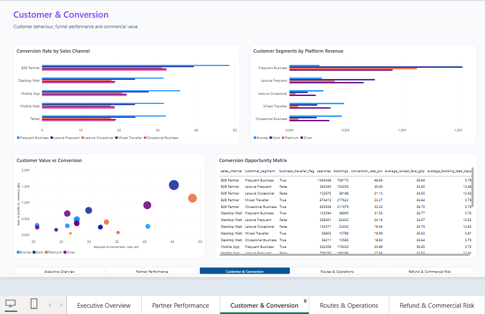
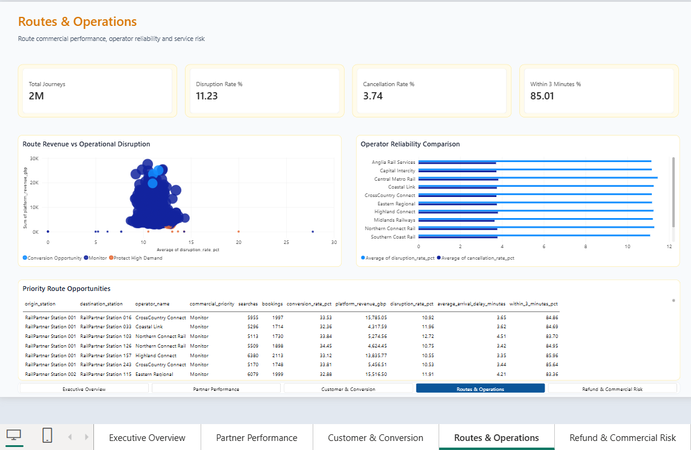
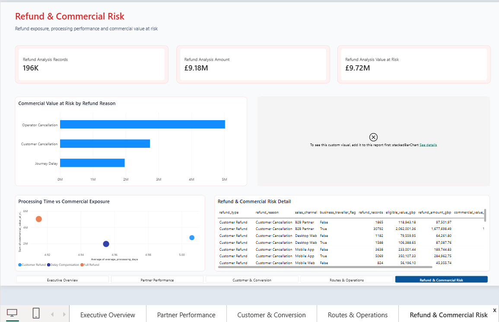
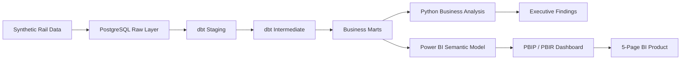

# RailPartner 360

## B2B Rail Retail & Customer Intelligence Platform

RailPartner 360 is an end-to-end analytics engineering and business intelligence portfolio project built to demonstrate how large-scale rail retail, customer, partner, commercial and operational data can be transformed into decision-ready insight.

The project models a modern rail retail environment containing **6 million searches, 2 million bookings, 250,000 customers, 50 B2B partners, 1,200 routes and 12 operators**.

The solution combines **PostgreSQL, SQL, dbt, Python, Power BI, PBIP, PBIR, TMDL, DAX, dimensional modelling, analytics engineering and automated validation**.

> **Data notice:** Transaction-level data is synthetic and was created solely for portfolio and analytical demonstration purposes. It does not contain Trainline or other proprietary customer data.

---

## Executive Summary

RailPartner 360 was designed around five commercial questions:

1. How effectively are searches converting into bookings?
2. Which B2B partners generate the greatest commercial value?
3. Which customer segments represent the strongest growth or retention opportunities?
4. Which routes and operators create the greatest operational risk?
5. Where are refunds creating the greatest financial exposure?

The final Power BI solution contains five analytical pages:

- Executive Overview
- Partner Performance
- Customer & Conversion
- Routes & Operations
- Refund & Commercial Risk

---

## Business Performance at a Glance

| KPI | Result |
|---|---:|
| Searches | 6,000,000 |
| Bookings | 2,000,000 |
| Overall Conversion Rate | 33.33% |
| Gross Booking Value | £136.40M |
| Platform Revenue | £9.03M |
| B2B Booking Share | 63.86% |
| Journeys | 2,000,000 |
| Disruption Rate | 11.23% |
| Cancellation Rate | 3.74% |
| Within 3 Minutes | 85.01% |
| Refund Records | 196,235 |
| Refund Amount | £9.18M |
| Commercial Value at Risk | £9.72M |

---

## Key Business Findings

### Partner Performance

- **63.86%** of bookings are associated with B2B activity.
- Highest-revenue partner: **Rail Commerce Partner 027**.
- Partner revenue: approximately **£217,451**.
- Highest-risk partner: **Rail Commerce Partner 026**.
- Commercial value at risk: approximately **£248,327**.

This demonstrates why partner monitoring should consider both revenue contribution and commercial exposure.

### Customer & Conversion

- Best-converting segment: **B2B Partner / Frequent Business — 48.69%**.
- Lowest-converting segment: **Mobile Web / Leisure Occasional — 17.86%**.
- Highest-value customer segment: **Frequent Business / Gold — approximately £1.54M platform revenue**.

The analysis identifies clear opportunities around mobile conversion optimisation and high-value customer retention.

### Routes & Operations

- Top revenue route: **RailPartner Station 034 → RailPartner Station 008**.
- Route revenue: approximately **£27,534**.
- Highest-disruption route: **RailPartner Station 094 → RailPartner Station 061 — 14.38%**.
- Key conversion opportunity: **RailPartner Station 212 → RailPartner Station 162**.
- Highest-disruption operator: **Central Metro Rail — 11.45%**.
- Best operational performer: **Southern Coast Rail — 11.09% disruption**.

The project combines commercial and operational metrics so routes can be prioritised using value and service quality together.

### Refund & Commercial Risk

- Refund records: **196,235**.
- Refund amount: approximately **£9.18M**.
- Commercial value at risk: approximately **£9.72M**.
- Largest identified refund-risk driver: **Full Refund / Operator Cancellation — approximately £2.85M at risk**.

This shows the relationship between service disruption and downstream financial exposure.

---

## Power BI Dashboard

### 1. Executive Overview

Executive-level view of searches, bookings, conversion, gross booking value, revenue, B2B contribution, operational reliability and commercial risk.



### 2. Partner Performance

B2B partner revenue, bookings, conversion, risk exposure, rankings, revenue-vs-conversion analysis and detailed partner performance.



### 3. Customer & Conversion

Customer segmentation, conversion performance, loyalty tiers, platform revenue, value-vs-conversion analysis and conversion opportunities.



### 4. Routes & Operations

Route revenue, disruption, cancellation, punctuality, operator reliability and route-level commercial opportunity analysis.



### 5. Refund & Commercial Risk

Refund volumes, refund value, commercial exposure, refund drivers, sales-channel exposure and processing performance.



---

## Architecture



---

## Data Architecture

The PostgreSQL warehouse uses four logical schemas:

```text
raw
staging
intermediate
marts
```

Core dimensions include partner, customer, operator, station, route, ticket and date.

Core fact tables include searches, bookings, journeys and refunds.

---

## dbt Transformation Layer

Key intermediate models:

```text
int_search_booking_funnel
int_booking_journey_enriched
```

Business marts:

```text
mart_executive_kpis
mart_partner_performance
mart_conversion_funnel
mart_customer_360
mart_route_performance
mart_operational_performance
mart_refund_impact
```

---

## Power BI Semantic Model

The final semantic model contains seven reporting tables:

```text
Executive KPIs
Partner Performance
Conversion Funnel
Customer Segments
Route Opportunity
Operator Performance
Refund Impact
```

Reusable DAX measures cover searches, bookings, conversion, gross booking value, revenue, B2B share, journey performance, disruption, cancellation, punctuality, refunds and commercial value at risk.

---

## Code-First Power BI Engineering

The Power BI solution uses **PBIP, PBIR and TMDL** so significant parts of the dashboard can be version-controlled and automated.

Python automation is used for:

- semantic-model construction
- PBIR page creation
- KPI card generation
- bar charts
- scatter plots
- analytical tables
- visual styling
- page backgrounds
- page navigation
- project validation

This creates a reproducible Power BI engineering workflow rather than a dashboard that exists only as manual UI work.

---

## Final Technical Validation

```text
Pages:     5
Visuals:  55
Tables:    7
Exports:   7
Errors:    0
Warnings:  0

FINAL VALIDATION: PASSED
```

---

## Technology Stack

### Data Engineering
- PostgreSQL
- SQL
- dbt
- Dimensional modelling
- Data marts
- Data-quality testing

### Analytics
- Python
- pandas
- psycopg2
- Funnel analysis
- Customer segmentation
- Commercial analytics
- Operational analytics

### Business Intelligence
- Microsoft Power BI
- DAX
- Power Query
- PBIP
- PBIR
- TMDL
- Semantic modelling
- Dashboard design
- Data storytelling

### Engineering
- VS Code
- Python automation
- Git
- GitHub
- JSON
- PowerShell

---

## Repository Structure

```text
railpartner-360/
├── data/
│   └── exports/
├── dbt/
├── docs/
│   └── screenshots/
├── powerbi/
│   ├── RailPartner_360.pbip
│   ├── RailPartner_360.Report/
│   └── RailPartner_360.SemanticModel/
├── reports/
├── src/
│   ├── analysis/
│   ├── automation/
│   ├── data_generation/
│   ├── database/
│   └── validation/
└── README.md
```

---

## Skills Demonstrated

- Analytics engineering
- SQL transformation
- Large-scale data handling
- Data modelling
- Commercial analytics
- Customer analytics
- Product and funnel analytics
- Operational analytics
- Executive BI reporting
- DAX and semantic modelling
- Power BI project engineering
- Python automation
- Data-quality validation
- Git-based development
- Business storytelling

---

## Business Recommendations

1. Prioritise high-value B2B partners while actively monitoring disproportionate risk exposure.
2. Investigate Mobile Web / Leisure Occasional conversion performance.
3. Protect and retain Frequent Business / Gold customers.
4. Combine route revenue and disruption when prioritising operational interventions.
5. Reduce operator-cancellation-driven refund exposure.

---

## Future Enhancements

- Booking-demand forecasting
- Customer lifetime value modelling
- Partner churn prediction
- Route demand forecasting
- Refund propensity modelling
- Anomaly detection
- MLflow experiment tracking
- Cloud deployment
- CI/CD for dbt and Power BI project files

---

## Author

**Oluwatosin Oluwaseun Mulero**

Data Analyst | Data Scientist

**SQL • Python • Power BI • PostgreSQL • dbt • Analytics Engineering • Machine Learning • Data Visualisation**
